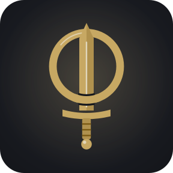

  

# Nothung: The Ring Card Game

A single-player collectible card game for Android, themed on Richard Wagner's *Der Ring des Nibelungen*. Built with Godot 4.7.2 and GDScript.

## Documentation

All design and technical documentation lives in [docs/](docs/README.md):

- [Functional documentation](docs/README.md#functional-documentation) — vision, lore, rules, cards, modes, UX
- [Technical documentation](docs/README.md#technical-documentation) — architecture, data model, engine, AI, build
- [Architecture Decision Records](docs/README.md#architecture-decision-records)
