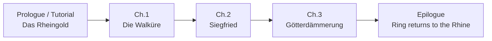

# Game modes

> Every way the player can play, and how modes connect.
> Status: Draft · Last updated: 2026-10-30

## Overview

| Mode | Purpose | Unlocked |
|------|---------|----------|
| Tutorial | Teach the rules | First launch (skippable) |
| Campaign | Story through the four operas | After tutorial |
| Quick match | Free play vs AI | After tutorial |
| Deck builder | Create / edit decks | After tutorial |

## Tutorial

- Integrated into the *Rheingold* prologue: the player plays Wotan against Alberich.
- Teaches step by step: playing a unit, Energy, attacking, Leader ability, traits, the Ring.
- Scripted hands and AI moves (deterministic).

## Campaign

Four chapters, each with 5–8 stages following the opera's story: mostly **duels**, plus 1–2 **[Quests](#quests-non-combat-stages)** (non-combat stages) per chapter.

- Each duel has a **fixed opponent** (character + preconstructed deck) and optionally **special rules** (e.g. "Fafner's lair: the enemy Leader starts with 35 Life").
- Story is told between duels with illustrated text panels (no voice acting in v1.0).
- Rewards: new cards, new Leaders, decks.
- The player can switch to their own deck or a chapter-provided deck.

> **Decision (2026-10-09):** Linear campaign in v1.0 — stages (duels and Quests) follow the story order. A node map with optional side duels is a post-launch idea.

### Quests (non-combat stages)

> **Decision (2026-10-14, confirmed 2026-10-15):** The v1.0 campaign includes **Quests**: narrative stages with choices, no duel. They give **rewards only** and have no effect on later duels, so duel balancing stays independent. Mime's riddle game, previously a post-launch idea, becomes a Quest.

A Quest is a short gamebook-style sequence that breaks the rhythm between duels (monster hunt, treasure hunt, journey, riddles).

- **3–6 steps**; each step = one illustration + a short text + **2–3 choices**.
- Choices branch toward **2–3 endings**. Each ending gives a different reward (card, Rhinegold or cosmetic — see [06-progression](06-progression.md#rewards)).
- **No failure:** every ending completes the Quest and the campaign moves on.
- **Replayable** from the chapter map, which shows the endings found and the ones still missing. Each ending's reward is granted once.
- **Canon:** the main path follows the libretto. A branch that departs from it is presented as a "what if" and never changes the story that follows ([canon notes](02-lore-and-setting.md#canon-notes-libretto)).

| Chapter | Quest | Theme |
|---------|-------|-------|
| *Das Rheingold* | **The Nibelheim hoard** | Treasure hunt: Wotan and Loge search Alberich's forges for the gold and the Tarnhelm |
| *Die Walküre* | **Flight through the forest** | Sieglinde escapes Hunding's hunt, choosing paths and hiding places |
| *Siegfried* | **The Wanderer's wager** | Riddle game: Mime and the Wanderer stake their heads on three questions |
| *Siegfried* | **Tracking Fafner** | Monster hunt: following the Woodbird's song to Neidhöhle, the dragon's cave |
| *Götterdämmerung* | **The Rhine journey** | The Rhinemaidens ask Siegfried for the Ring (canon ending: he refuses) |

## Quick match

- Choose your deck, choose opponent deck (or random), choose difficulty (Easy / Normal / Hard).
- Random draws a deck of another faction. The last choices are remembered for the next Quick match.
- Your deck is one of **your decks that are ready to play** (deck builder); the opponent plays a starter deck. With no deck ready, Play is greyed out and the screen says where to complete one.
- Gives small rewards (see [06-progression](06-progression.md)).

## Deck builder

- Browse collection with filters (faction, cost, type, rarity, trait, owned/not owned).
- Create, rename, duplicate, delete decks; live validation of deck rules.
- Mana-curve chart and card-type breakdown.
- Number of deck slots: 12.
- A new deck starts from its **Leader** (one of the Leaders owned) and is empty; the Leader cannot be changed afterwards (duplicate the deck or start a new one).
- Only cards of the Leader's faction and Neutral cards can be added, up to the copy limit and the copies owned. A deck can be saved unfinished; only decks **ready to play** (20 cards, every rule met) are offered in Quick match.
- The four starter decks are copied into the player's decks once (they can then be edited like any deck).
- Every change is saved at once; there is no Save button.
- Cards are added by **drag and drop** onto the deck zone (hold a moment to pick a card up, so the grid still scrolls with a swipe), and taken out by dragging them out of it or tapping them.

> **Decision (2026-10-30):** the deck editor is **one screen with drag and drop** (deck zone above the cards), not two tabs.

> **Decision (2026-10-30):** the starter decks are **editable copies** in the player's 12 slots (not fixed decks next to them). A deck without a name shows its faction's name.

## Optional / post-launch ideas

- **Challenges**: puzzles ("win this turn").
- **Gauntlet**: chain of AI duels with escalating difficulty, roguelike-lite.
- **Daily duel**: offline seed-based daily challenge.

## Multiplayer (planned for v2)

Not part of v1.0 (single player vs AI only). Mentioned here so v1.0 choices don't block it later.

> **Decision (2026-10-12):** v2 multiplayer = **online duel** against another player (friend invite and/or matchmaking). No local pass-and-play on a single device.

Points to define when v2 is designed:
- Accounts, collection and anti-cheat (the v1.0 collection is stored only on the device).
- Fairness: whether online duels use the player's collection or pre-built / fully unlocked decks.
- Turn timer (none in v1.0) and disconnection handling.
