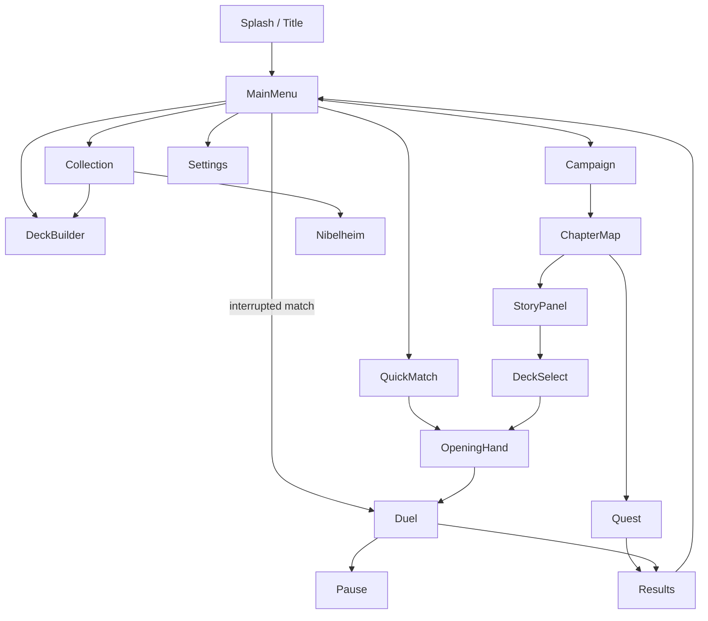

# UI / UX

> Screens, navigation and interaction design for an Android phone.
> Status: Draft · Last updated: 2026-11-18

> **Decision (2026-10-30):** the main menu is built around the **current deck** (Leader portrait in the centre, deck builder under it); the game modes sit below it, Nibelheim and Settings in the top corners, Collection — the least used — small at the bottom.

## Platform constraints

- **Portrait** orientation, one-handed use where possible.
- Reference resolution 1080×1920; must adapt from 16:9 to 20:9+ aspect ratios and display cutouts (notches).
- Minimum touch target: 48 dp.
- Android back button must always do something sensible (go back / open pause menu).

> **Decision (2026-10-09):** Portrait orientation for the whole game, duel screen included.

## Screen flow



## Screens

| Screen | Key elements |
|--------|--------------|
| Title | Game name, subtitle, sword emblem, **Start** (the startup screen doubles as the title) |
| Main menu | Top: **Nibelheim** (forge icon + name, the Rhinegold under it) on the left, the **player level** in the middle ("Level 3", a gold XP bar, "25 / 40 XP"; while a level reward waits, the XP rune on its left that wiggles every couple of seconds, and "Reward to claim!": a tap claims it, with a message at the top), **Achievements** (trophy; while an achievement waits to be claimed, the trophy wiggles the same way) and **Settings** (cog) on the right; the title. Centre: the **current deck** (Leader portrait framed in the faction colour — the faction icon until the Leader's art exists —, then, unframed, deck name and Leader), then **My decks** (card-exchange icon) and **Change deck** (cycle icon; lists the decks ready to play, centred vertically; the choice is also Quick match's deck) side by side, then — still in the middle block — **Campaign** (greyed out until it exists) and **Quick match** side by side; **Collection**, smaller, at the bottom. Without a deck ready to play, the deck panel says so and Change deck is greyed out; **Resume match** prompt (Resume / Abandon) when a match was interrupted ([persistence](../technical/07-persistence.md#resume-an-interrupted-match)) |
| Quick match | **Your deck**: only the current deck (faction icon, name, Leader) and **Change deck** (the same list as in the main menu); the opponent (**Random**, then the four starter decks on one row: tall tiles with the faction icon on top, faction and Leader under it); difficulty Easy / Normal / Hard with a one-line description; **Play** right under them (not at the bottom of the screen); the whole block is centred vertically under the title. Last choices remembered |
| Chapter map | Chapter nodes (duels and Quests), progress, rewards preview, Quest endings found / missing |
| Quest | Illustration (top), story text, 2–3 choice buttons (≥ 48 dp); back opens a pause menu (resume / quit Quest) |
| Deck select | Deck list, Leader portrait, validity indicator |
| Opening hand | Near full-screen panel, the cards drawn on **two centred rows**, at hand size (2 + 2 for four cards, 3 + 2 for five) (long press zooms); **New hand** (Refresh icon) redraws the whole hand, as many times as wanted, the new cards fading in; **Keep this hand** (highlighted) starts the match; flavour title "The Norns weave your fate" |
| Götterdämmerung | Popup opened automatically at the first Götterdämmerung damage of the match, once the damage ("-1 Götterdämmerung" on the Leader) has been shown (red frame): what it does; closed by **Understood** or a tap outside the panel. Once per match ([rules](03-game-rules.md#götterdämmerung-turn-limit)) |
| Pause | Themed panel: **Resume** (primary), **Leave** (red text, like every destructive button); leaving asks for confirmation inside the panel. The Android back button opens / closes it during a match |
| **Duel** | Top bar: whose turn (no how-to instructions: the gold, red and green borders show what to tap, greyed cards and buttons what cannot be used), turn number (each player counts their own turns), Götterdämmerung countdown (from turn 7, then "Valhalla burns" once it is active), pause. One identical panel per Leader (portrait, name, Life, Energy, named ability: Energy cost, name and effect at the top left of its button). At the start of a turn under the Götterdämmerung, the Leader flashes flame orange and "-2" rises from it with **Götterdämmerung** under the number. Framed enemy and own play areas. Battle log + Undo + End turn just above the hand (bottom) |
| Results | Animated icon, **played twice, then still** — victory: laurel crown that pops up then glows in gold; defeat: broken shield that falls once, wiggles, then dims; draw: crossed swords that pop up — then win/lose (unframed); right under it the **XP** (XP icon, "+30 XP", the level gauge filling from where it was before the match, over again at each level reached, the level number popping); the Rhinegold won; then the achievements reached in **one gold frame** (one trophy, "Achievement to claim", a line per achievement) — they grow in one after the other and their icon glows twice; then **Play again** (after a win or a draw) or **Rematch** (after a defeat) — same decks and difficulty — and **Home** |
| Collection | Rhinegold counter; no links (My decks and Nibelheim are in the main menu). Faction chips (All + one icon per faction) always shown; **Filters** (with the number of active filters) unfolds chip rows for cost (0–5, 6+), type, rarity, trait and owned / missing — one chip per row, "All" first; each row has its caption on the left (Energy, with the Energy icon; Type; Rarity; Trait; Copies) so the chips line up. Count "owned / shown". Grid of 3 cards per row, by faction, cost, then name; under each card "× n" or "Not owned" (card faded). Tapping a card opens it large with its flavour and "Owned: n (up to m per deck)"; tapping anywhere closes it |
| My decks | One tile per deck — one per faction, the starter decks' copies —: faction icon and colour, name, Leader · "Ready to play" or the first problem ("17 / 20 cards"); a tap opens the editor; the list is centred vertically. No New deck, Duplicate or Delete |
| Deck editor | One screen, **no drag and drop**. Top: faction icon, **name** (the faction's, not editable), Leader; the **Leader's power** in use ("Power: Walvater — Deal 2 damage to a unit. (2 Energy)") with **Change the Leader's power** (a list of the base ability and the powers, the locked ones greyed with "unlocked in Nibelheim from level 5"); state ("Ready to play" in gold, or every problem in red). **Deck zone**: "Deck n / 20" with a **gauge** (Energy blue while filling, gold at 20), units / spells / artifacts, one chip per card (cost · name × copies, framed in the card's colour; empty: how to add cards). Below: the Leader's faction and Neutral cards, filters as in the Collection with "Owned" preselected, "in deck / available" under each card. **Tap a card to add a copy** — or, if it cannot be added, the card shows large with why; each chip has a red **X** that takes a copy out; a **long press** on its name shows the card large (copies in the deck); a plain tap on the name does nothing. A card whose available copies are all in the deck leaves the list below. A vertical swipe scrolls and never adds a card. At the bottom: **Auto-fill** and **Starter deck** (both replace the cards; on a deck that is not empty they ask first, Cancel highlighted), then **Empty the deck** (red text, asks first; hidden when the deck is empty). Leaving a deck that cannot be played (Back or the Android back button) opens a popup: "Deck not complete", its problems, **Keep editing** (highlighted) or **Leave** (red) |
| Achievements | Rhinegold counter; "n / 13 unlocked"; one row per achievement: trophy (gold once unlocked, grey before), name, what to do, progress ("3 / 10") or Unlocked, reward ("+20 Rhinegold · +25 XP"); the list is centred vertically and scrolls. A reached achievement shows **Claim**; claiming it pays its Rhinegold and XP with a message at the top of the screen (trophy icon). An achievement reached in Nibelheim shows the same kind of message |
| Nibelheim | Rhinegold counter; one line of story; two tabs. **Cards**: the Collection filters; the cards still missing copies (up to a deck's worth), each with "owned / max · price". A tap shows the card large with **Forge — price** (greyed, with the Rhinegold missing, when short). **Leaders**: one panel per Leader (border in the faction colour) with its base ability and its two powers — name, effect, Energy cost — and, for each power, Unlocked or its price (greyed with "From level 5" or the Rhinegold missing); unlocking shows a message at the top of the screen |
| Settings | Music and sound-effect volumes, language (device language or English / Deutsch / Español / Français); **reset progress** (collection, decks, Rhinegold, campaign, achievements; asks for confirmation, Cancel highlighted; settings are kept). The content is centred vertically under the title |

## Duel screen layout (portrait)

> **Decision (2026-10-20):** Information is grouped by owner. Each Leader has **one panel**, identical for both players; turn and match information sit together in the top bar; the battle log sits just above the hand, next to End turn; play areas are framed instead of separated by lines.

```
┌──────────────────────────────────────┐
│ [YOUR TURN                     ] [PAUSE] │  match info
│ [Turn 7 · Götterdämmerung in 3 ]         │
│ ┌ Enemy Leader ──────────────────────┐ │
│ │ (A) Alberich  ♥20 ◆0/0  [Lord of the   │ │  portrait · name · Life · Energy
│ │                              Nibelungs ◆2]│ │  named ability (read-only)
│ └────────────────────────────────────┘ │
│ ┌ ENEMY UNITS ───────────────────────┐ │
│ │ ▢ ▢ ▢ ▢ units          │ ARTIFACTS │ │  framed play area:
│ │ ▢ ▢ (wraps)             │ ▫ ▫ ▫     │ │  units left, artifacts right
│ └────────────────────────────────────┘ │
│ ┌ YOUR UNITS ────────────────────────┐ │
│ │ ▢ ▢ ▢ units             │ ARTIFACTS │ │  whole frame = drop zone
│ │                         │ ▫ ▫ ▫     │ │  3 slots, reduced cards
│ └────────────────────────────────────┘ │
│ ┌ Your Leader (gold border) ─────────┐ │
│ │ (portrait) Wotan ♥20 ◆1/1 [Spear of │ │  same panel, ability is the button
│ │                            Treaties ◆3]│ │
│ └────────────────────────────────────┘ │
│ [BATTLE LOG · last 3 lines] [UNDO] [END TURN] │
│   ╭──╮╭──╮╭──╮╭──╮╭──╮  hand (scroll) │
└──────────────────────────────────────┘
```

- **Leader panel** (both players): portrait (or the Leader's initial while there is no art), name, Life, Energy, and the ability as a button showing its **name**, cost and effect. The opponent's ability button is read-only. Tapping the panel targets that Leader.
- Ability names come from `cards/leaders.md` (`ability_name`): Wotan — *Spear of Treaties*, Alberich — *Lord of the Nibelungs*, Siegfried — *Spear-breaker*, Brünnhilde — *Chooser of the Slain*.
- A Leader playing with a power shows the power's name and effect instead (`cards/leader_powers.md`: German names, e.g. *Wotans Zorn*).
- The two play areas share the free height, so the hand stays at the bottom whatever the screen ratio.
- **Artifacts** have their own column on the **right** of each play area, after a thin line: a small "Artifacts" title, then **3 slots** shown even when empty, the cards at ~60 % of a unit card (long press shows them large). The Ring and limit-exempt artifacts can add a 4th slot, which goes again when they leave. Units take the rest of the width and wrap onto a second row.
- A unit carrying a **Relic** (Nothung, Tarnhelm…) shows it as a **badge** above its stats (the Relic's name in a pill bordered in its faction colour): a Relic is not in the artifact column. Its long press adds "Carries: Nothung (+3/+0)" and the Relic's text. A spell that reforges a Relic asks which unit carries it (the valid ones glow green, as for any card played on one of your units).

> **Decision (2026-11-18, playtest):** artifacts get a **dedicated column on the right** of each play area (3 slots, reduced cards), instead of a row above the units.
- **The hand never scrolls**: all cards fit the width and overlap when there are more than five; the selected card is drawn on top.
- **Play areas wrap**: when units do not fit on one line (up to 6 per side), they continue on a second line instead of widening the screen.
- Icons (Life, Energy, pause, end turn, undo, close, settings, Nibelheim forge, achievements trophy, XP rune stone) come from game-icons.net ([CREDITS](../../CREDITS.md)); faction and card-type icons will be hand-drawn ([art & audio](08-art-and-audio.md#icons)).
- A painted board can sit behind the duel (`assets/art/boards/<board_id>.png`, dimmed); see [art & audio](08-art-and-audio.md#duel-backgrounds).

## Gestures

| Action | Gesture |
|--------|---------|
| Inspect card | Long press → the card itself, drawn as in the hand and on the board but larger (current stats, Relic badge), its flavour under it, then the duel's lines (why it cannot be played or attack, the Relic carried) and **Close** (text only) — the same presentation as a card opened in the Collection |
| Play card | Drag from hand onto the highlighted own play area (or onto a target) — or tap-tap (below) |
| Target colours | While a card, an attack or an ability is chosen (tap or drag), its valid targets glow **red** on the enemy side and **green** on the player's side (a buff on your unit, your Leader to heal) |
| Attack | **Tap-tap only** (units are never dragged). Units that can attack now have a **gold border**. **Tap the unit, then a target**: while a unit is selected, its valid targets get a **red border** (enemy units, and the enemy Leader panel when it can be hit — only Guard units while the enemy has some). Tap the unit again to cancel |
| Leader ability | Tap the ability button in the own Leader panel. Untargeted: it is used at once. Targeted (e.g. *Spear of Treaties*): the button turns **gold** and valid targets get a **red border** (enemy) or a **green border** (your own units and Leader); tap a target, or the button again to cancel. Greyed out when it cannot be used now (not enough Energy, already used this turn, no target) |
| Unit that cannot attack | Dimmed on the board; tapping it does nothing. Its details (long press) explain why: played this turn (attacks next turn unless it has Charge), already attacked this turn, or nothing to attack |
| Cancel drag | Release outside a valid target; the card stays where it was |
| Undo last play | Tap **Undo play** before taking another action; the card returns to the hand and the match state is restored to before it was played |
| Tap-tap (no drag) | **1st tap selects** the card (gold border, own play area highlighted); **2nd tap** on the play area — or on a target for targeted cards — plays it. Tapping the selected card again cancels. A single tap never plays a card. |
| Unplayable card | Greyed out in the hand, cannot be selected or dragged; tapping it does nothing. Its details (long press) show why (not enough Energy: X needed / Y available, board full, artifact limit, Legendary artifact already yours, no unit to carry the Relic, no valid target, not your turn) |

## Feedback

- The own-side drop zone spans the artifact and unit rows and is visibly highlighted while dragging a card.
- A complete card preview follows the pointer during a drag; Godot's platform-native drag preview is disabled to keep Android rendering consistent.
- Valid targets glow; invalid ones dim.
- **Invisible** units (Tarnhelm) are drawn see-through (45 % opacity) on both boards until they attack; the opponent can never select them as a target meanwhile.
- **Undo play** is available after the most recent card play and disappears after the next action or turn end. Undo restores the state before the play, including any resolved play effects; the card is back in hand.

> **Decision (2026-11-23, playtest):** an undone card goes back to the **hand**, not on top of the deck (undoing *Siegmund* seemed to lose him).
- Duel controls, cards and text scale to the available viewport height to prevent bottom-edge clipping in shorter editor/debug windows. Board rows reserve card height even while empty, preventing the window from resizing when the AI plays a unit; the hand remains horizontally scrollable.
- Every rules event has an animation + sound (damage numbers, death, draw). Implemented (sounds to come), durations at 1× speed:

| Moment | Animation |
|--------|-----------|
| Spell played | The card rises from where it was played to the centre and grows (0.25 s), glows (0.2 s), then strikes its target with a gold burst, or fades out when it has no target (0.25 s). Enemy spells come out of the enemy Leader panel |
| Attack | The attacker lifts (0.12 s), lunges at its target (0.2 s), which flashes red, then returns (0.25 s) |
| Damage | A red "-N" floats up from each damaged unit or Leader |
| Unit destroyed | Red tint and shake, then the card shrinks, sinks and fades (0.35 s) |
| Card drawn | A card back flies in from the right edge and turns into the card at its place in the hand (0.3 s). Enemy draws: a small card back slides into the enemy Leader panel |

- The screen is locked while an animation plays (about 0.5–1 s); the AI waits for each animation before its next step.
- AI turn is visible step by step.
- Log of the last actions accessible from the duel screen.

> **Playable match (2026-10-16):** the initial duel is launched from the splash screen. Tap-to-select/tap-target and drag-and-drop controls are verified on Android, as is long-press card zoom. A full match was played to its result screen on the Android emulator.

## Accessibility

- Colour-blind safe faction colours (don't rely on colour alone — use icons).
- No time pressure on the player's turn.
- Haptic feedback toggle.
