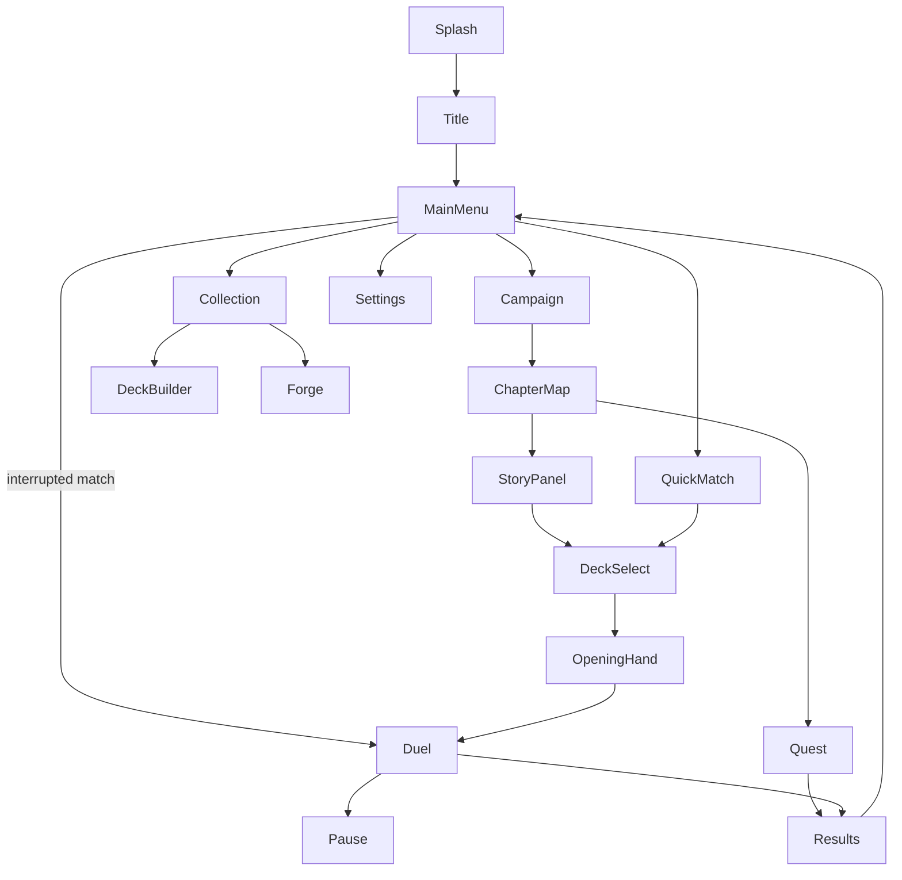

# UI / UX

> Screens, navigation and interaction design for an Android phone.
> Status: Draft · Last updated: 2026-10-20

## Platform constraints

- **Portrait** orientation, one-handed use where possible.
- Reference resolution 1080×1920; must adapt from 16:9 to 20:9+ aspect ratios and display cutouts (notches).
- Minimum touch target: 48 dp.
- Android back button must always do something sensible (go back / open pause menu).

> **Decision (2026-10-09):** Portrait orientation for the whole game, duel screen included.

## Screen flow



## Screens

| Screen | Key elements |
|--------|--------------|
| Main menu | Campaign, Quick match, Collection, Settings; Rhinegold counter; **Resume match** prompt (Resume / Abandon) when a match was interrupted ([persistence](../technical/07-persistence.md#resume-an-interrupted-match)) |
| Chapter map | Chapter nodes (duels and Quests), progress, rewards preview, Quest endings found / missing |
| Quest | Illustration (top), story text, 2–3 choice buttons (≥ 48 dp); back opens a pause menu (resume / quit Quest) |
| Deck select | Deck list, Leader portrait, validity indicator |
| Opening hand | Starting cards, tap to mark cards to replace, **Redraw** button, then confirm; flavour line "The Norns weave your fate…" |
| **Duel** | Top bar: whose turn, turn number, Götterdämmerung countdown, pause. One identical panel per Leader (portrait, name, Life, Energy, card counts, named ability). Framed enemy and own play areas. Battle log + Undo + End turn just above the hand (bottom) |
| Results | Win/lose, rewards, continue |
| Collection / Deck builder | Card grid, filters, deck list panel, mana curve |
| Settings | Audio volumes, language, animation speed, reset progress |

## Duel screen layout (portrait)

> **Decision (2026-10-20):** Information is grouped by owner. Each Leader has **one panel**, identical for both players; turn and match information sit together in the top bar; the battle log sits just above the hand, next to End turn; play areas are framed instead of separated by lines.

```
┌──────────────────────────────────────┐
│ [YOUR TURN                     ] [PAUSE] │  match info
│ [Turn 1 · Götterdämmerung in 9 ]         │
│ ┌ Enemy Leader ──────────────────────┐ │
│ │ (A) Alberich  ♥20 ◆0/0  [Lord of the   │ │  portrait · name · Life · Energy
│ │     Deck · Graveyard · Hand  Nibelungs ◆2]│ │  counts · named ability (read-only)
│ └────────────────────────────────────┘ │
│ ┌ ENEMY UNITS ───────────────────────┐ │
│ │ artifacts (when any) / ▢ ▢ ▢ units   │ │  framed play area
│ └────────────────────────────────────┘ │
│ ┌ YOUR UNITS ────────────────────────┐ │
│ │ artifacts (when any) / ▢ ▢ ▢ units   │ │  whole frame = drop zone
│ └────────────────────────────────────┘ │
│ ┌ Your Leader (gold border) ─────────┐ │
│ │ (portrait) Wotan ♥20 ◆1/1 [Spear of │ │  same panel, ability is the button
│ │  Deck · Graveyard · Hand   Treaties ◆3]│ │
│ └────────────────────────────────────┘ │
│ [BATTLE LOG · last 3 lines] [UNDO] [END TURN] │
│   ╭──╮╭──╮╭──╮╭──╮╭──╮  hand (scroll) │
└──────────────────────────────────────┘
```

- **Leader panel** (both players): portrait (or the Leader's initial while there is no art), name, Life, Energy, deck / graveyard / hand counts, and the ability as a button showing its **name**, cost and effect. The opponent's ability button is read-only. Tapping the panel targets that Leader.
- Ability names come from `cards/leaders.md` (`ability_name`): Wotan — *Spear of Treaties*, Alberich — *Lord of the Nibelungs*.
- The two play areas share the free height, so the hand stays at the bottom whatever the screen ratio.

## Gestures

| Action | Gesture |
|--------|---------|
| Inspect card | Long press → zoomed card with full text and trait tooltips |
| Play card | Drag from hand onto the highlighted own-side drop zone (or onto a target) |
| Attack | Drag from own unit to target; valid targets highlighted |
| Cancel drag | Release outside a valid target; the card stays where it was |
| Undo last play | Tap **Undo play** before taking another action; the card returns to the top of the deck and the match state is restored to before it was played |
| Accessibility alternative | Tap card → tap target (no drag required) |

## Feedback

- The own-side drop zone spans the artifact and unit rows and is visibly highlighted while dragging a card.
- A complete card preview follows the pointer during a drag; Godot's platform-native drag preview is disabled to keep Android rendering consistent.
- Valid targets glow; invalid ones dim.
- **Undo play** is available after the most recent card play and disappears after the next action or turn end. Undo restores the state before the play, including any resolved play effects.
- Duel controls, cards and text scale to the available viewport height to prevent bottom-edge clipping in shorter editor/debug windows. Board rows reserve card height even while empty, preventing the window from resizing when the AI plays a unit; the hand remains horizontally scrollable.
- Every rules event has an animation + sound (damage numbers, death, draw).
- AI turn is visible step by step; speed configurable (1×, 2×, instant).
- Log of the last actions accessible from the duel screen.

> **Playable match (2026-10-16):** the initial duel is launched from the splash screen. Tap-to-select/tap-target and drag-and-drop controls are verified on Android, as is long-press card zoom. A full match was played to its result screen on the Android emulator.

## Accessibility

- Text size option; colour-blind safe faction colours (don't rely on colour alone — use icons).
- No time pressure on the player's turn.
- Haptic feedback toggle.
