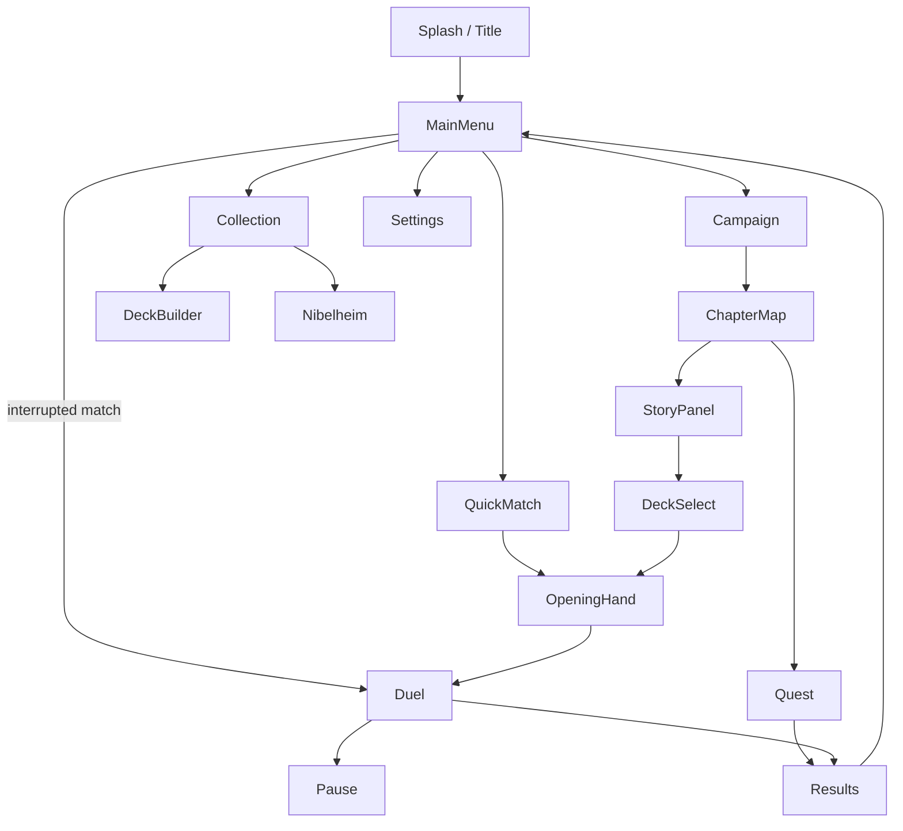

# UI / UX

> Screens, navigation and interaction design for an Android phone.
> Status: Draft · Last updated: 2026-10-30

## Platform constraints

- **Portrait** orientation, one-handed use where possible.
- Reference resolution 1080×1920; must adapt from 16:9 to 20:9+ aspect ratios and display cutouts (notches).
- Minimum touch target: 48 dp.
- Android back button must always do something sensible (go back / open pause menu).

> **Decision (2026-10-09):** Portrait orientation for the whole game, duel screen included.

## Screen flow



## Screens

| Screen | Key elements |
|--------|--------------|
| Title | Game name, subtitle, sword emblem, **Start** (the startup screen doubles as the title) |
| Main menu | Campaign, Quick match, Collection, Settings; Rhinegold counter; **Resume match** prompt (Resume / Abandon) when a match was interrupted ([persistence](../technical/07-persistence.md#resume-an-interrupted-match)) |
| Quick match | Your deck (your decks ready to play: name and Leader; scrolls beyond four) and the opponent's (**Random** or a starter deck) as tiles with faction icon, faction and Leader; difficulty Easy / Normal / Hard with a one-line description; **Play**. Last choices remembered |
| Chapter map | Chapter nodes (duels and Quests), progress, rewards preview, Quest endings found / missing |
| Quest | Illustration (top), story text, 2–3 choice buttons (≥ 48 dp); back opens a pause menu (resume / quit Quest) |
| Deck select | Deck list, Leader portrait, validity indicator |
| Opening hand | Near full-screen panel, cards in a grid sized to fit (never scrolls); tap to mark cards to put back (gold border, dimmed), then **Redraw selected**; flavour title "The Norns weave your fate" |
| Götterdämmerung | Popup opened automatically at the first Götterdämmerung damage of the match (red frame): what it does; closed by **Understood** or a tap outside the panel. Once per match ([rules](03-game-rules.md#götterdämmerung-turn-limit)) |
| Pause | Themed panel: **Resume** (primary), **Leave**; leaving asks for confirmation inside the panel. The Android back button opens / closes it during a match |
| **Duel** | Top bar: whose turn (no how-to instructions: the gold and red borders show what to tap, greyed cards and buttons what cannot be used), turn number (each player counts their own turns), Götterdämmerung countdown (from turn 7, then "Valhalla burns" once it is active), pause. One identical panel per Leader (portrait, name, Life, Energy, named ability). Framed enemy and own play areas. Battle log + Undo + End turn just above the hand (bottom) |
| Results | Win/lose, rewards ("+20 Rhinegold" after a Quick match win), continue |
| Collection | Rhinegold counter. Faction chips (All + one icon per faction) always shown; **Filters** (with the number of active filters) unfolds chip rows for cost (0–5, 6+), type, rarity, trait and owned / missing — one chip per row, "All" first; each row has its caption on the left (Energy, with the Energy icon; Type; Rarity; Trait; Copies) so the chips line up. Count "owned / shown". Grid of 3 cards per row, by faction, cost, then name; under each card "× n" or "Not owned" (card faded). Tapping a card opens it large with its flavour and "Owned: n (up to m per deck)"; tapping anywhere closes it |
| Collection links | **My decks** (highlighted) and **Nibelheim**, side by side under the header |
| My decks | Slots used ("4 / 12"); **New deck** (greyed with a message when the 12 slots are used) asks for the Leader among those owned, creates the empty deck and opens it; one tile per deck: faction icon and colour, name, Leader · "Ready to play" or the first problem ("17 / 20 cards") |
| Deck editor | Always in sight: faction icon, **name** (framed field; empty = the faction's name), Leader, state ("Ready to play" in gold, or every problem in red). Two tabs: **Cards** (the Leader's faction and Neutral cards, filters as in the Collection with "Owned" preselected; under each card "in deck / available"; a tap adds a copy, or shows the card with why it cannot be added) and **Deck (n / 20)** (Energy curve 0–6+, units / spells / artifacts, "Tap a card to take it out", one row per card: cost, name, × copies; then **Duplicate** and **Delete**, which asks first, Cancel highlighted) |
| Nibelheim | Rhinegold counter; one line of story; the Collection filters; the cards still missing copies (up to a deck's worth), each with "owned / max · price". A tap shows the card large with **Forge — price** (greyed, with the Rhinegold missing, when short) |
| Settings | Music and sound-effect volumes, language (device language or English / Deutsch / Español / Français); **reset progress** (collection, decks, Rhinegold, campaign, achievements; asks for confirmation, Cancel highlighted; settings are kept) |

## Duel screen layout (portrait)

> **Decision (2026-10-20):** Information is grouped by owner. Each Leader has **one panel**, identical for both players; turn and match information sit together in the top bar; the battle log sits just above the hand, next to End turn; play areas are framed instead of separated by lines.

```
┌──────────────────────────────────────┐
│ [YOUR TURN                     ] [PAUSE] │  match info
│ [Turn 7 · Götterdämmerung in 3 ]         │
│ ┌ Enemy Leader ──────────────────────┐ │
│ │ (A) Alberich  ♥20 ◆0/0  [Lord of the   │ │  portrait · name · Life · Energy
│ │                              Nibelungs ◆2]│ │  named ability (read-only)
│ └────────────────────────────────────┘ │
│ ┌ ENEMY UNITS ───────────────────────┐ │
│ │ artifacts (when any) / ▢ ▢ ▢ units   │ │  framed play area
│ └────────────────────────────────────┘ │
│ ┌ YOUR UNITS ────────────────────────┐ │
│ │ artifacts (when any) / ▢ ▢ ▢ units   │ │  whole frame = drop zone
│ └────────────────────────────────────┘ │
│ ┌ Your Leader (gold border) ─────────┐ │
│ │ (portrait) Wotan ♥20 ◆1/1 [Spear of │ │  same panel, ability is the button
│ │                            Treaties ◆3]│ │
│ └────────────────────────────────────┘ │
│ [BATTLE LOG · last 3 lines] [UNDO] [END TURN] │
│   ╭──╮╭──╮╭──╮╭──╮╭──╮  hand (scroll) │
└──────────────────────────────────────┘
```

- **Leader panel** (both players): portrait (or the Leader's initial while there is no art), name, Life, Energy, and the ability as a button showing its **name**, cost and effect. The opponent's ability button is read-only. Tapping the panel targets that Leader.
- Ability names come from `cards/leaders.md` (`ability_name`): Wotan — *Spear of Treaties*, Alberich — *Lord of the Nibelungs*, Siegfried — *Spear-breaker*, Brünnhilde — *Chooser of the Slain*.
- The two play areas share the free height, so the hand stays at the bottom whatever the screen ratio.
- **The hand never scrolls**: all cards fit the width and overlap when there are more than five; the selected card is drawn on top.
- **Play areas wrap**: when units do not fit on one line (up to 6 per side), they continue on a second line instead of widening the screen.
- Icons (Life, Energy, pause, end turn, undo, close) come from game-icons.net ([CREDITS](../../CREDITS.md)); faction and card-type icons will be hand-drawn ([art & audio](08-art-and-audio.md#icons)).
- A painted board can sit behind the duel (`assets/art/boards/<board_id>.png`, dimmed); see [art & audio](08-art-and-audio.md#duel-backgrounds).

## Gestures

| Action | Gesture |
|--------|---------|
| Inspect card | Long press → zoomed card with full text and trait tooltips |
| Play card | Drag from hand onto the highlighted own play area (or onto a target) — or tap-tap (below) |
| Attack | **Tap-tap only** (units are never dragged). Units that can attack now have a **gold border**. **Tap the unit, then a target**: while a unit is selected, its valid targets get a **red border** (enemy units, and the enemy Leader panel when it can be hit — only Guard units while the enemy has some). Tap the unit again to cancel |
| Leader ability | Tap the ability button in the own Leader panel. Untargeted: it is used at once. Targeted (e.g. *Spear of Treaties*): the button turns **gold** and valid targets get a **red border**; tap a target, or the button again to cancel. Greyed out when it cannot be used now (not enough Energy, already used this turn, no target) |
| Unit that cannot attack | Dimmed on the board; tapping it does nothing. Its details (long press) explain why: played this turn (attacks next turn unless it has Charge), already attacked this turn, or nothing to attack |
| Cancel drag | Release outside a valid target; the card stays where it was |
| Undo last play | Tap **Undo play** before taking another action; the card returns to the top of the deck and the match state is restored to before it was played |
| Tap-tap (no drag) | **1st tap selects** the card (gold border, own play area highlighted); **2nd tap** on the play area — or on a target for targeted cards — plays it. Tapping the selected card again cancels. A single tap never plays a card. |
| Unplayable card | Greyed out in the hand, cannot be selected or dragged; tapping it does nothing. Its details (long press) show why (not enough Energy: X needed / Y available, board full, artifact limit, no valid target, not your turn) |

## Feedback

- The own-side drop zone spans the artifact and unit rows and is visibly highlighted while dragging a card.
- A complete card preview follows the pointer during a drag; Godot's platform-native drag preview is disabled to keep Android rendering consistent.
- Valid targets glow; invalid ones dim.
- **Invisible** units (Tarnhelm) are drawn see-through (45 % opacity) on both boards until they attack; the opponent can never select them as a target meanwhile.
- **Undo play** is available after the most recent card play and disappears after the next action or turn end. Undo restores the state before the play, including any resolved play effects.
- Duel controls, cards and text scale to the available viewport height to prevent bottom-edge clipping in shorter editor/debug windows. Board rows reserve card height even while empty, preventing the window from resizing when the AI plays a unit; the hand remains horizontally scrollable.
- Every rules event has an animation + sound (damage numbers, death, draw). Implemented (sounds to come), durations at 1× speed:

| Moment | Animation |
|--------|-----------|
| Spell played | The card rises from where it was played to the centre and grows (0.25 s), glows (0.2 s), then strikes its target with a gold burst, or fades out when it has no target (0.25 s). Enemy spells come out of the enemy Leader panel |
| Attack | The attacker lifts (0.12 s), lunges at its target (0.2 s), which flashes red, then returns (0.25 s) |
| Damage | A red "-N" floats up from each damaged unit or Leader |
| Unit destroyed | Red tint and shake, then the card shrinks, sinks and fades (0.35 s) |
| Card drawn | A card back flies in from the right edge and turns into the card at its place in the hand (0.3 s). Enemy draws: a small card back slides into the enemy Leader panel |

- The screen is locked while an animation plays (about 0.5–1 s); the AI waits for each animation before its next step.
- AI turn is visible step by step.
- Log of the last actions accessible from the duel screen.

> **Playable match (2026-10-16):** the initial duel is launched from the splash screen. Tap-to-select/tap-target and drag-and-drop controls are verified on Android, as is long-press card zoom. A full match was played to its result screen on the Android emulator.

## Accessibility

- Colour-blind safe faction colours (don't rely on colour alone — use icons).
- No time pressure on the player's turn.
- Haptic feedback toggle.
