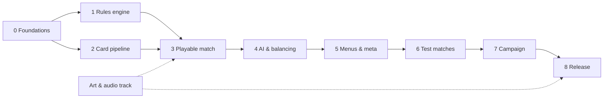

# Roadmap

> Development milestones from the spec to the first Google Play release, with progress tracking.
> Status: Draft · Last updated: 2026-10-30

Principle: reach a **playable match on the phone** as early as possible (milestone 3), then measure match length to validate the rules (Götterdämmerung at turn 10, Ring curse) before building the meta and the campaign.

Tick items (`- [x]`) as they are done. A milestone is complete when its **Done when** criterion is met.

## Overview

| # | Milestone | Done when… | Status |
|---|-----------|------------|--------|
| 0 | [Foundations](#0--foundations) | Tests run headless from the command line | Done |
| 1 | [Rules engine](#1--rules-engine-headless) | A scripted match runs to the end in a test | Done |
| 2 | [Card pipeline](#2--card-pipeline) | The validator rejects an invalid card | Done |
| 3 | [**Playable match**](#3--playable-match) | A full match vs AI on the phone | Done |
| 4 | [AI & balancing](#4--ai--balancing) | Average match length 5–7 min | In progress |
| 5 | [Menus & meta](#5--menus--meta) | Full loop without debug tools | In progress (achievements and phone checks left) |
| 6 | [Test matches](#6--test-matches) | Artifacts and the Ring checked in real matches on the phone | To do |
| 7 | [Campaign](#7--campaign) | Prologue + chapter 1 playable | To do |
| 8 | [Release](#8--release) | Internal build on Google Play | To do |
| – | [Art & audio track](#art--audio-track-in-parallel) | Runs in parallel, no code dependency | In progress |

## 0 — Foundations

- [x] Godot project, portrait 1080×1920, GL Compatibility ([architecture](technical/01-architecture.md))
- [x] Splash screen; default Godot boot splash disabled ([UI implementation](technical/06-ui-implementation.md#splash))
- [x] UI theme + palette ([UI implementation](technical/06-ui-implementation.md#theme))
- [x] App icon and Android export preset, package `io.github.tuntematonsotilas.nothung` ([build & release](technical/10-build-and-release.md#export-presets))
- [x] Install gdUnit4 (v6.2.2, pinned) and headless test suite ([testing](technical/09-testing.md))
- [x] Folder skeleton (`core/`, `ai/`, `autoload/`, `data/`, `tests/`…) ([project structure](technical/02-project-structure.md))
- [x] Autoloads: `SceneRouter` (fade, history, back button), `SaveManager` (atomic JSON, backup, migrations), `Settings` (ConfigFile, language)
- [x] Localisation setup: CSV with EN source + DE / ES / FR columns, language setting; splash texts translated
- [x] Game translated into DE / ES / FR (menus, duel, all cards; German flavour from the original libretto); a test fails on untranslated texts. Native-speaker review still to do
- [x] Split the export preset into `Android Debug` (`.apk`) and `Android Release` (`.aab`), as documented

## 1 — Rules engine (headless)

No `Node` dependency; everything tested ([game engine](technical/04-game-engine.md), [data model](technical/03-data-model.md)).

- [x] `CardData`, `AbilityData`, `ConditionData`, `EffectData` resources; `LeaderData`, `DeckData`
- [x] `GameState`, `PlayerState`, `Zone`, `CardInstance`; seeded RNG; `duplicate_state()`
- [x] `Match` API: setup, opening hand + Redraw, turn phases, legal actions
- [x] Actions: play card, attack, Leader ability, end turn
- [x] Energy, combat, traits (Guard, Charge, Flying, Valhalla), triggers and data-driven effects
- [x] Relic bearer restrictions, conditional reforging and shattering when a bearer dies
- [x] The Ring (bonus, curse, stealing) and Götterdämmerung
- [x] Victory / defeat / draw
- [x] Integration test: full scripted match + recorded-action replay with state hash ([determinism helpers](technical/09-testing.md#determinism-helpers))

## 2 — Card pipeline

- [x] `cards/<faction>.md` format ([card authoring](technical/03-data-model.md#card-authoring-pipeline))
- [x] Converter `cards/*.md` → `game/data/cards/**/*.tres` + English localisation entries
- [x] Validator (unknown trait / effect / trigger = error) + check mode that fails on a diff (run before committing)
- [x] First ~20 cards: Gods vs Nibelungs (tutorial matchup) + 2 Leaders (Wotan, Alberich)
- [x] Two starter decks

## 3 — Playable match

- [x] Duel screen layout (portrait) ([UI / UX](functional/07-ui-ux.md#duel-screen-layout-portrait-draft))
- [x] `CardView` with placeholder art (frame colour by faction, rarity badge, generated rules text)
- [x] Hand, board, Leader, Energy and Life views driven by `Match` events
- [x] Input: drag-and-drop + tap-tap mode; long press → zoom
- [x] Opening hand screen with Redraw
- [x] Easy AI on a worker thread ([AI opponent](technical/05-ai-opponent.md))
- [x] Results screen
- [x] **Play a full match on the phone**
- [x] Animations: spell, attack (lunge + damage numbers), draw, unit destroyed; speed setting respected
- [x] Götterdämmerung explanation popup; per-player turn counter and countdown from turn 7

## 4 — AI & balancing

- [x] Improve Easy AI action selection: evaluate card value, lethal attacks and favorable trades
- [x] Normal (greedy over simulated actions) and Hard (information-set MCTS) difficulties; AI profiles with personalities; AI never sees the opponent's hand; non-blocking AI thread in the duel ([AI opponent](technical/05-ai-opponent.md))
- [x] AI vs AI soak tests: no crash, no illegal move ([testing](technical/09-testing.md))
- [x] Match-length and win-rate stats per starter deck ([AI soak baseline](technical/09-testing.md#ai-soak))
- [x] Tune Götterdämmerung start from the stats: stays at turn 10 (fires in 45–58 % of matches, 8.7–9.6 turns per player) ([AI soak](technical/09-testing.md#ai-soak))
- [x] Remaining cards to ~80 (4 factions + Neutral) ([cards](functional/04-cards.md))
  - [x] Wälsungs: 15 cards, Leader Siegfried, starter deck
  - [x] One Legendary per faction: Wotan's Spear (Gods), Tarnhelm (Nibelungs), Nothung (Wälsungs); Invisible trait. Balance: Gods 59 % vs Nibelungs, Wälsungs 53 % vs Gods, Nibelungs 55 % vs Wälsungs
  - [x] Valkyries: 15 cards (one per sister, two unnamed heroes), Leader Brünnhilde, Legendary *Ride of the Valkyries*, starter deck. All 12 starter matchups within 40–60 % ([AI soak](technical/09-testing.md#ai-soak))
  - [x] Neutral: 20 cards (Rhinemaidens, Woodbird, Norns, Erda, Giants, Gibichungs, Hunding), Legendary *Hagen*; Fafner, Hagen and *The Giants' Wage* can take the Ring. Covered by the AI soak with a test deck (Alberich + each Neutral card once)
  - [x] Gods and Nibelungs up to 15 cards each: Froh, Fricka's Rams, The Wanderer, Rainbow Bridge; Alberich the Toad, Mime's Cave, The Anvils of Nibelheim — 80 cards in all, every starter matchup within 43–57 %
  - [x] *Potion of Forgetfulness* (Neutral spell, Epic, 5): take control of an enemy unit costing 4 or less — new `take_control` effect; 81 cards

## 5 — Menus & meta

- [x] Title and main menu: Quick match, Collection, Settings, Rhinegold counter; Campaign greyed out until it exists ([UI implementation](technical/06-ui-implementation.md#menus))
- [x] Quick match (your deck ready to play / opponent starter deck or Random / difficulty, last choices remembered)
- [x] Collection screen: every card with the copies owned, faction chips + filters (cost, type, rarity, trait, owned / missing), card shown large; new profile owns the four starter decks
- [x] Deck builder (decks from the collection, starter decks copied as editable decks, 12 slots), Quick match with the player's decks ([game modes](functional/05-game-modes.md#deck-builder))
- [x] Nibelheim (card crafting with Rhinegold) + Quick match rewards ([progression](functional/06-progression.md))
- [x] Profile save (atomic JSON, backup, migrations, removed cards → Rhinegold) ([persistence](technical/07-persistence.md)): collection, Leaders, decks, Rhinegold
- [x] Resume an interrupted match (Quick match; campaign duels will add their own fields) ([persistence](technical/07-persistence.md#resume-an-interrupted-match))
- [x] Settings: music / sound-effect volumes, language, reset progress ([UI implementation](technical/06-ui-implementation.md#menus))
- [ ] Achievements ([progression](functional/06-progression.md#achievements-examples))
- [ ] Check on the phone: scrolling the card grids with a finger (a scroll must not open a card), typing a deck name with the Android keyboard, resuming after the app is force-stopped mid-duel, menu titles clear of the notch

## 6 — Test matches

Real matches on the phone, once the deck choice of milestone 5 exists.

- [ ] Test a match with artifacts: play *Wotan's Spear* and *The Valkyrie Rock*, attach the *Tarnhelm* (Invisible) and *Nothung*, check that Nothung shatters and is reforged (Siegmund, *Notung! Notung!*)
- [ ] Test a match with the Ring: forge it with *Renunciation of Love* (Nibelungs), check the holder's bonus (+2 Energy and 1 card with Alberich, +1 Energy otherwise), the curse at the end of each of the holder's turns (1, 2, 3, then 3 Life) and *Waltraute* sending it back to the Rhine; then tune the curse from these matches and the AI soak

## 7 — Campaign

- [ ] Chapter map, story panels
- [ ] Campaign duels with fixed opponents and special rules; AI personalities
- [ ] Quests (non-combat stages) ([game modes](functional/05-game-modes.md#quests-non-combat-stages))
- [ ] Tutorial in the *Rheingold* prologue
- [ ] Prologue + chapter 1 (*Die Walküre*), then chapters 2–3 and the epilogue

## 8 — Release

- [ ] Final art for every card (no placeholder left) ([artwork policy](tools/art-tools.md#artwork-policy))
- [ ] Store listing: 512 × 512 icon, feature graphic, screenshots, descriptions in EN / DE / ES / FR
- [ ] Privacy policy, data safety form, content rating ([store checklist](technical/10-build-and-release.md#store-requirements-checklist))
- [ ] Manual test checklist on reference + low-end + tall-aspect devices ([testing](technical/09-testing.md#manual-test-checklist-release))
- [ ] Signed `.aab` → Internal testing → Closed testing

## Art & audio track (in parallel)

No code dependency: can start now ([art & audio](functional/08-art-and-audio.md), [art tools](tools/art-tools.md)).

- [x] Card colour system, faction palette, rarity colours (letter badge)
- [x] Art direction: Romantic painting
- [x] App icon: Nothung through the Ring
- [ ] Mood board (validates the faction palette)
- [ ] Paper workflow test on 2–3 cards: ink + digital colour vs watercolour
- [ ] Full logo with the title, built on the icon emblem
- [x] Card frames drawn by the game: rectangles, double border with a motif by type (spell / artifact / relic), faction colour on border + name banner, rarity letter badge ([card frames](functional/08-art-and-audio.md#card-frames))
- [x] Faction icons (game-icons.net)
- [ ] Card-type and trait icons
- [ ] Leitmotif stingers and first music loop ([audio tools](tools/audio-tools.md))
- [ ] Sound effects: draw, play, attack, damage, death, end turn
