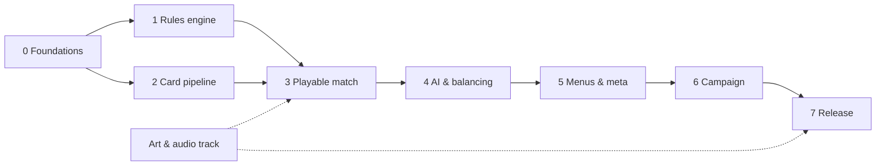

# Roadmap

> Development milestones from the spec to the first Google Play release, with progress tracking.
> Status: Draft · Last updated: 2026-10-16

Principle: reach a **playable match on the phone** as early as possible (milestone 3), then measure match length to validate the rules (Götterdämmerung at turn 10, Ring curse) before building the meta and the campaign.

Tick items (`- [x]`) as they are done. A milestone is complete when its **Done when** criterion is met.

## Overview

| # | Milestone | Done when… | Status |
|---|-----------|------------|--------|
| 0 | [Foundations](#0--foundations) | Tests run headless from the command line | Done |
| 1 | [Rules engine](#1--rules-engine-headless) | A scripted match runs to the end in a test | Done |
| 2 | [Card pipeline](#2--card-pipeline) | The validator rejects an invalid card | Done |
| 3 | [**Playable match**](#3--playable-match) | A full match vs AI on the phone | In progress |
| 4 | [AI & balancing](#4--ai--balancing) | Average match length 5–7 min | To do |
| 5 | [Menus & meta](#5--menus--meta) | Full loop without debug tools | To do |
| 6 | [Campaign](#6--campaign) | Prologue + chapter 1 playable | To do |
| 7 | [Release](#7--release) | Internal build on Google Play | To do |
| – | [Art & audio track](#art--audio-track-in-parallel) | Runs in parallel, no code dependency | In progress |

## 0 — Foundations

- [x] Godot project, portrait 1080×1920, GL Compatibility ([architecture](technical/01-architecture.md))
- [x] Splash screen; default Godot boot splash disabled ([UI implementation](technical/06-ui-implementation.md#splash))
- [x] UI theme + palette ([UI implementation](technical/06-ui-implementation.md#theme))
- [x] App icon and Android export preset, package `io.github.tuntematonsotilas.nothung` ([build & release](technical/10-build-and-release.md#export-presets))
- [x] Install gdUnit4 (v6.2.2, pinned) and headless test suite ([testing](technical/09-testing.md))
- [x] Folder skeleton (`core/`, `ai/`, `autoload/`, `data/`, `tests/`…) ([project structure](technical/02-project-structure.md))
- [x] Autoloads: `SceneRouter` (fade, history, back button), `SaveManager` (atomic JSON, backup, migrations), `Settings` (ConfigFile, language)
- [x] Localisation setup: CSV with EN source + DE / ES / FR columns, language setting; splash texts translated
- [x] Split the export preset into `Android Debug` (`.apk`) and `Android Release` (`.aab`), as documented

## 1 — Rules engine (headless)

No `Node` dependency; everything tested ([game engine](technical/04-game-engine.md), [data model](technical/03-data-model.md)).

- [x] `CardData`, `AbilityData`, `ConditionData`, `EffectData` resources; `LeaderData`, `DeckData`
- [x] `GameState`, `PlayerState`, `Zone`, `CardInstance`; seeded RNG; `duplicate_state()`
- [x] `Match` API: setup, opening hand + Redraw, turn phases, legal actions
- [x] Actions: play card, attack, Leader ability, end turn
- [x] Energy, combat, traits (Guard, Charge, Flying, Valhalla), triggers and data-driven effects
- [x] Relic bearer restrictions, conditional forging and shattering when a bearer dies
- [x] The Ring (bonus, curse, stealing) and Götterdämmerung
- [x] Victory / defeat / draw
- [x] Integration test: full scripted match + recorded-action replay with state hash ([determinism helpers](technical/09-testing.md#determinism-helpers))

## 2 — Card pipeline

- [x] `cards/<faction>.md` format ([card authoring](technical/03-data-model.md#card-authoring-pipeline))
- [x] Converter `cards/*.md` → `game/data/cards/**/*.tres` + English localisation entries
- [x] Validator (unknown trait / effect / trigger = error) + check mode that fails on a diff (run before committing)
- [x] First ~20 cards: Gods vs Nibelungs (tutorial matchup) + 2 Leaders (Wotan, Alberich)
- [x] Two starter decks

## 3 — Playable match

- [x] Duel screen layout (portrait) ([UI / UX](functional/07-ui-ux.md#duel-screen-layout-portrait-draft))
- [ ] `CardView` with placeholder art (frame colour by faction, gem, generated rules text)
- [x] Hand, board, Leader, Energy and Life views driven by `Match` events
- [ ] Input: drag-and-drop + tap-tap mode; long press → zoom (tap-to-select is implemented)
- [x] Opening hand screen with Redraw
- [x] Easy AI on a worker thread ([AI opponent](technical/05-ai-opponent.md))
- [x] Results screen
- [ ] **Play a full match on the phone**

## 4 — AI & balancing

- [ ] Normal and Hard difficulties; AI profiles
- [ ] AI vs AI soak tests: no crash, no illegal move ([testing](technical/09-testing.md))
- [ ] Match-length and win-rate stats per deck
- [ ] Tune Götterdämmerung start (turn 10 vs 8) and the Ring curse from the stats ([game rules](functional/03-game-rules.md))
- [ ] Remaining cards to ~80 (4 factions + Neutral) ([cards](functional/04-cards.md))

## 5 — Menus & meta

- [ ] Title and main menu
- [ ] Quick match (deck / opponent / difficulty)
- [ ] Collection, deck builder, Forge ([game modes](functional/05-game-modes.md), [progression](functional/06-progression.md))
- [ ] Profile save (atomic JSON, migrations) ([persistence](technical/07-persistence.md))
- [ ] Resume an interrupted match
- [ ] Settings: audio, language, animation speed, text size
- [ ] Achievements

## 6 — Campaign

- [ ] Chapter map, story panels
- [ ] Campaign duels with fixed opponents and special rules; AI personalities
- [ ] Quests (non-combat stages) ([game modes](functional/05-game-modes.md#quests-non-combat-stages))
- [ ] Tutorial in the *Rheingold* prologue
- [ ] Prologue + chapter 1 (*Die Walküre*), then chapters 2–3 and the epilogue

## 7 — Release

- [ ] Final art for every card (no placeholder left) ([artwork policy](tools/art-tools.md#artwork-policy))
- [ ] Store listing: 512 × 512 icon, feature graphic, screenshots, descriptions in EN / DE / ES / FR
- [ ] Privacy policy, data safety form, content rating ([store checklist](technical/10-build-and-release.md#store-requirements-checklist))
- [ ] Manual test checklist on reference + low-end + tall-aspect devices ([testing](technical/09-testing.md#manual-test-checklist-release))
- [ ] Signed `.aab` → Internal testing → Closed testing

## Art & audio track (in parallel)

No code dependency: can start now ([art & audio](functional/08-art-and-audio.md), [art tools](tools/art-tools.md)).

- [x] Card colour system, faction palette, gem colours
- [x] Art direction: Romantic painting
- [x] App icon: Nothung through the Ring
- [ ] Mood board (validates the faction palette)
- [ ] Paper workflow test on 2–3 cards: ink + digital colour vs watercolour
- [ ] Full logo with the title, built on the icon emblem
- [ ] Card frames: 4 shapes × 5 faction colours + Ring / Cursed
- [ ] Faction and trait icons
- [ ] Leitmotif stingers and first music loop ([audio tools](tools/audio-tools.md))
- [ ] Sound effects: draw, play, attack, damage, death, end turn
