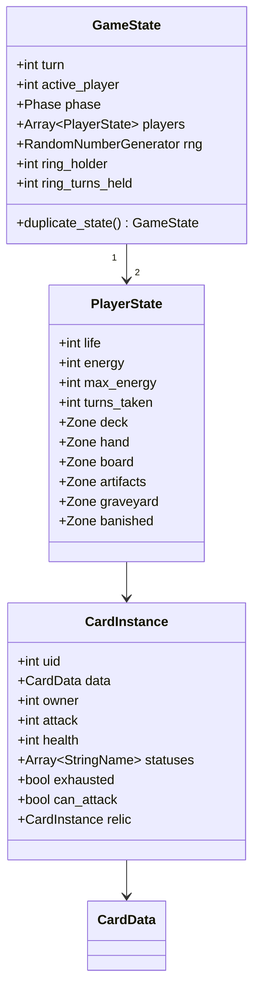

# Data model

> How cards, decks and effects are represented as data. Implements [functional/04-cards.md](../functional/04-cards.md).
> Status: Draft · Last updated: 2026-10-16

## Principles

- **Data-driven**: a new card should normally need *zero* new code — only a new row in `cards/<faction>.md` composed of existing effects.
- **Static vs runtime**: `CardData` (immutable definition, a `Resource`) is separate from `CardInstance` (runtime object in a match, `RefCounted`).
- **Stable IDs**: saves and decks reference cards by `id: StringName`, never by file path.

## Static definitions (Resources)

```gdscript
class_name CardData
extends Resource

enum Type { UNIT, SPELL, ARTIFACT }
enum Rarity { COMMON, RARE, EPIC, LEGENDARY }

@export var id: StringName
@export var faction: StringName          # &"gods", &"nibelungs", … , &"neutral"
@export var type: Type
@export var subtypes: Array[StringName]  # &"dwarf", &"weapon"…
@export var rarity: Rarity
@export var cost: int
@export var attack: int                  # units only
@export var health: int                  # units only
@export var keywords: Array[StringName]  # &"guard", &"charge"…
@export var bearer: Array[StringName]    # Relics only: allowed subtypes or card ids (&"walsung"); empty = any unit
@export var abilities: Array[AbilityData]
@export var leitmotifs: Array[StringName]
@export var art: Texture2D               # optional until the art track fills it
# name / rules text / flavour come from translation keys derived from `id`
```

```gdscript
class_name AbilityData
extends Resource

@export var trigger: StringName          # &"on_play", &"on_death", &"start_of_turn"…
@export var condition: ConditionData     # optional
@export var cost: int                    # used by a Leader ability
@export var effects: Array[EffectData]   # ordered, each effect carries its target
```

`EffectData` is a typed Resource with a `Kind`, `Target`, numeric values, an optional keyword and an optional `CardData` reference. Supported kinds are damage, draw, energy, summon, heal, buff, transform, resurrect, Ring create/steal/return, and forge. `ConditionData` supports `controls(card_id)` and `holds_ring`.

Other resources: `LeaderData` (life, ability), `DeckData` (leader + ordered card definitions), `CampaignDuelData` (opponent deck, AI profile, special rules, rewards), `CampaignQuestData` (non-combat stage: steps, each with an illustration, a text key and choices pointing to the next step or to an ending; reward per ending — [Quests](../functional/05-game-modes.md#quests-non-combat-stages)). Quest texts go in the localisation file, like card names.

The rules-engine Resources are implemented in `game/data/cards/` and `game/data/{leaders,decks}/`: `CardData`, `AbilityData`, `ConditionData`, `EffectData`, `LeaderData`, and `DeckData`. For the initial engine milestone, `DeckData.cards` contains `CardData` references (the Markdown card pipeline and ID-to-resource database are milestone 2); authored definitions are treated as immutable during a match. `CardData.is_ring`, `attachable`, `bearer`, relic bonuses, `bonus_damage_faction`, and `shatters_into` encode signature artifact and combat cases in data; the Ring's named Alberich bonus is a game-specific rule.

## Runtime model (RefCounted)



- `uid` is unique per match (cards with the same `CardData` are distinguishable).
- `duplicate_state()` performs a deep copy for AI simulation.
- `relic`: the Relic attached to this unit (`null` if none; max 1 — [Relic rules](../functional/03-game-rules.md#relics-equipment)). An attached Relic is not in any zone while attached.
- `ring_holder`: index of the player holding the Ring, `-1` if it is not in play; `ring_turns_held` drives the curse and resets when the Ring changes hands ([The Ring](../functional/03-game-rules.md#the-ring-signature-mechanic)).
- `duplicate_state()` copies zones, instances, statuses, attached Relics and RNG state; immutable definitions remain shared.

## Card authoring pipeline

> **Decision (2026-10-09):** Cards are authored as **Markdown tables** in `cards/<faction>.md` (source of truth) and converted to `.tres` by a script. See [ADR-0002](../adr/0002-cards-authored-in-markdown.md).

Why Markdown: readable on GitHub and in VS Code, easy to diff and review, the whole card set of a faction fits on one page for balancing.

### Source format

One file per faction (`cards/gods.md`, `cards/nibelungs.md`, `cards/walsungs.md`, `cards/valkyries.md`, `cards/neutral.md`), one table row per card:

```markdown
| id | name | type | subtypes | rarity | cost | atk | hp | keywords | bearer | abilities | leitmotifs | flavour |
|----|------|------|----------|--------|------|-----|----|----------|--------|-----------|------------|---------|
| alberich_lord | Alberich, Lord of the Nibelungs | unit | dwarf | legendary | 4 | 3 | 4 | | | on_play: gain_energy(2); on_play[holds_ring]: draw(1) | energy, ring | *(libretto quote)* |
| loge_fire | Loge's Fire | spell | | rare | 3 | | | | | on_play: damage(all_enemy_units, 2) | fire | |
| nothung | Nothung | artifact | relic, weapon | legendary | | | | | walsung | static: buff(bearer, atk 3); on_bearer_death: shatter(nothung_broken) | sword | |
```

- `faction` comes from the file name.
- `bearer` is filled for Relics only (subtypes or card ids, comma-separated); empty = any unit.
- `name` and `flavour` are the **English** source text; the converter writes them into the `en` column of the localisation file. German, Spanish and French are translated there.
- `abilities` uses a small syntax: `trigger[condition]: effect(args); …`. Every trigger, condition, effect and keyword must exist in the engine; unknown names are errors.
- Rules text shown on the card is **generated from `keywords` + `abilities`**, so it can never disagree with the actual behaviour.

### Converter

- Written in GDScript (one language for the whole project), run with headless Godot from the command line; exact command documented in the tool's header once written.
- Parses every `cards/*.md`, validates (see below), writes `game/data/cards/<faction>/<id>.tres` and updates the English localisation entries.
- Generated `.tres` files are committed (the Godot project opens without running the tool) but **never edited by hand**.
- A check mode re-runs the converter and fails if it produces a diff (source and generated files out of sync); run it before committing.

## Validation

The converter, plus a debug-only check at startup and in the tests, verifies every card:
- unique `id`, translation keys present, art assigned,
- units have attack/health, spells have at least one ability,
- referenced effects/targets are valid.
