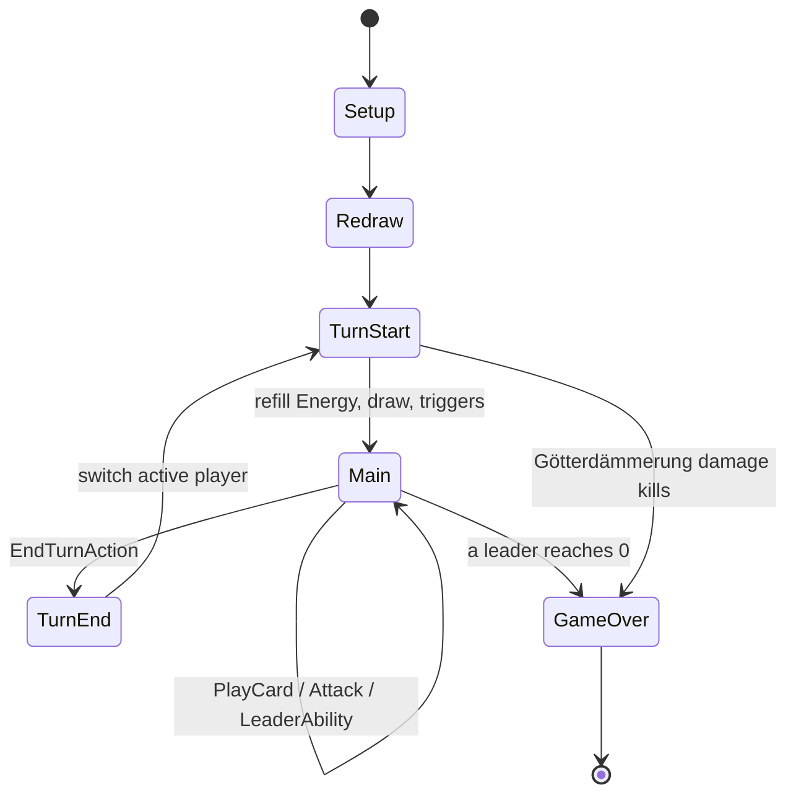

# Game engine

> The rules engine: state, turn flow, actions, effect resolution. Implements [functional/03-game-rules.md](../functional/03-game-rules.md).
> Status: Implemented · Last updated: 2026-10-30

## Responsibilities

- Hold the complete `GameState` ([03-data-model](03-data-model.md#runtime-model-refcounted)).
- Validate and apply player `Action`s.
- Run the turn state machine.
- Resolve triggered abilities and effects in a deterministic order.
- Emit `GameEvent`s for the presentation layer and the log.

No Node, no `await`, no timers inside `core/` — everything is synchronous and deterministic.

## Match API

```gdscript
class_name Match
extends RefCounted

signal event_emitted(event: GameEvent)
signal match_ended(winner: int)

func _init(deck_a: DeckData, deck_b: DeckData, seed: int) -> void
func get_state() -> GameState                 # read-only usage by views
func get_legal_actions(player: int) -> Array[Action]
func is_legal(action: Action) -> bool
func apply(action: Action) -> bool             # false leaves state unchanged when illegal
func state_hash() -> String                    # SHA-256 over canonical runtime state
```

Implementation: `game/core/match/match.gd`. Match setup validates two 20-card decks (leader faction or Neutral, rarity copy limits), assigns unique card instance IDs, shuffles both decks and selects the starting player with the match RNG. The opening hands contain four cards for the starting player and five for the other; each player can Redraw once, then the first turn starts. The second player receives one extra Energy on their first turn.

Actions are `RefCounted` value objects in `core/actions/`. `Action.to_record()` and `Action.from_record()` encode/decode replay-safe JSON dictionaries. They contain stable instance IDs and primitive values, never scene nodes or resource paths. `MatchRecord` (`core/match/match_record.gd`) stores them with the seed and deck snapshots to resume an interrupted match ([persistence](07-persistence.md#resume-an-interrupted-match)).

`get_legal_actions(player)` returns the possible action objects for that player in the current phase. During Redraw, each subset of the current hand is offered. During the Main phase, unit-targeting actions are expanded per valid target. `is_legal()` remains the authority: illegal actions return `false` without changing the state.

## Turn state machine

[Turn phases](../functional/03-game-rules.md#turn-phases) are modelled as an enum + transition function.



## Actions (command pattern)

| Action | Payload |
|--------|---------|
| `RedrawAction` | card uids to replace |
| `PlayCardAction` | card uid, optional target (for a Relic: the bearer unit — required) |
| `AttackAction` | attacker uid, target uid (unit or leader) |
| `UseLeaderAbilityAction` | optional target |
| `EndTurnAction` | – |
| `ConcedeAction` | – |

Each action is a small `RefCounted` value object. Its JSON-compatible record enables replays, bug reports, and AI search.

### Validation rules worth noting

- **Relics** ([rules](../functional/03-game-rules.md#relics-equipment)): the target must be a unit controlled by the player, without a Relic, matching `CardData.bearer` (subtype or card id). `get_legal_actions()` only offers valid bearers, so the UI highlights them and the AI never tries an illegal one.
- **Conditional reforging** (e.g. Siegmund reforges Nothung only if *Nothung (broken)* is among your artifacts): expressed as an ability condition (`[controls(nothung_broken)]`; `controls` checks your units, artifacts and Leader), checked like any other condition.
- **Ring bonus**: full vs reduced bonus is a condition on the holder (`[controls(alberich)]`), evaluated at the start of the holder's turn.

## Effect resolution

1. An action or event produces **triggers** (`on_play`, `on_death`, `on_bearer_death`, `start_of_turn`, `end_of_turn`, `on_attack`, `on_damage`).
2. Triggers are pushed onto a **FIFO resolution queue** in a deterministic order: active player first, then board position left→right.
3. The resolver pops one, checks its condition, resolves targets, runs its effects.
4. Effects may emit events that create new triggers → appended to the queue.
5. After each step, **state-based checks**: destroy units at ≤ 0 health, check victory.
6. A safety limit of 500 resolved abilities per action prevents infinite loops; exceeding it reports an error and ends the match as a draw.

`EffectData.Kind` currently implements damage (optionally doubled against a `bonus_faction`), draw, energy, summon, heal, buff (granting Charge lets the unit attack this turn), transform, resurrect, Ring creation/stealing/return, conditional reforging, artifact creation and taking control of an enemy unit. **Invisible** units (trait or relic) cannot be attacked or selected by the opponent until they attack (they then get the `revealed` status); a hidden Guard does not restrict attacks. A forge effect's `amount` is the additional Energy cost and it only charges when its condition is met and a valid relic bearer exists. Target selectors include a selected unit, either leader, all units on one/both boards, both leaders, the source card, and an equipped relic's bearer. `ConditionData` currently supports holding the Ring and controlling a named card. New cards compose these data objects rather than adding card-specific engine code.

Relics use `CardData.bearer` subtype/card IDs and `attachable`; they add their configured stats/keywords to a matching unit. A dead bearer moves its relic to the graveyard, or creates `shatters_into` in the owner's artifact zone. Conditional `reforge` effects replace an artifact with a relic and attach it to a valid bearer: the reforging unit itself when it can carry it, else the first valid one. A reforge triggered by a spell or a unit uses, as material, the relic's `shatters_into` artifact among your artifacts. Reforging costs no extra Energy. Only a Nibelung-faction card can create the Ring, and it cannot be created again while already held. The Ring is represented by `GameState.ring_holder`, not an artifact in a player's zone. Götterdämmerung damage starts on each player's tenth turn and increases by one on each of their later turns.

`GameEvent` records the authoritative engine event with owner and instance IDs. The engine does not know which client is viewing it; any network or presentation adapter must filter private card details before forwarding events to the opponent.

## Randomness

- One `RandomNumberGenerator` stored in `GameState`, seeded at match creation.
- All randomness (shuffle, random targets) goes through it — never `randi()` globally.
- AI simulations use a copy so they don't consume the real RNG.

## Events

`GameEvent` is a compact event record with `type`, owner, card/target IDs, amount, and turn. Current event types include `card_drawn`, `card_played`, `unit_summoned`, `damage_dealt`, `unit_destroyed`, `energy_changed`, `turn_started`, `turn_ended`, `relic_attached`, `relic_detached`, `ring_taken`, `ring_cursed`, and `match_ended`.

Events carry only what the receiving player is allowed to see (hidden information filter applied before emission to the human player's view).
