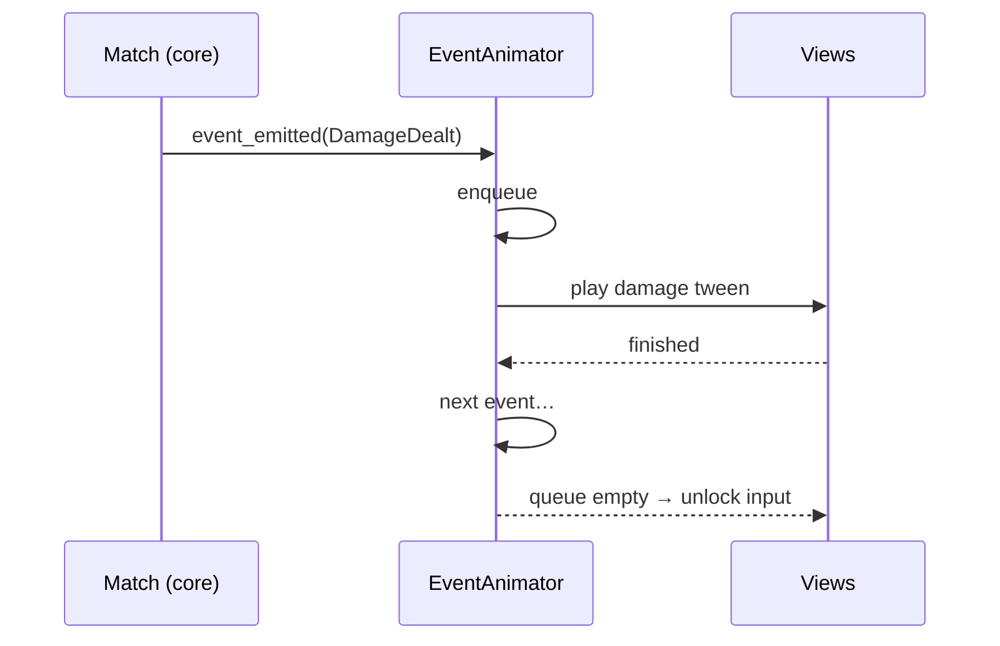

# UI implementation

> How screens and interactions from [functional/07-ui-ux.md](../functional/07-ui-ux.md) are built in Godot.
> Status: In progress · Last updated: 2026-10-16

## Display settings (`project.godot`)

| Setting | Value |
|---------|-------|
| `display/window/size/viewport_width × height` | 1080 × 1920 |
| `display/window/handheld/orientation` | Portrait |
| `display/window/stretch/mode` | `canvas_items` |
| `display/window/stretch/aspect` | `expand` (layouts use anchors/containers to absorb extra height) |
| Safe area | Read `DisplayServer.get_display_safe_area()` and pad the root UI for notches |

## Scene composition

- One scene per screen under `scenes/screens/`, swapped by the `SceneRouter` autoload (with a fade transition). The splash now starts a Gods-vs-Nibelungs duel.
- Reusable components under `scenes/components/`; the first `CardView` and portrait duel screen are implemented.
- UI built with `Control` nodes and containers; a shared `Theme` resource in `ui/theme/` for fonts, colours, styleboxes.

## Theme

- `ui/theme/main_theme.tres` is the project theme (`gui/theme/custom` in `project.godot`): every `Control` inherits it, popups and menus included.
- `ui/theme/palette.gd` (`class_name Palette`) holds the same colours as constants for scripts (`Palette.LIFE`, `Palette.ACCENT`…). Source of truth: [UI palette](../functional/08-art-and-audio.md#ui-palette). A `.tres` can't reference script constants, so a colour change must be made in both files.
- Variations instead of per-node overrides: `LabelAccent`, `LabelMuted`, `ButtonPrimary` (set with `theme_type_variation`). Avoid `theme_override_colors` in scenes.

## Splash

- `scenes/screens/splash.tscn` is the project's startup scene.
- The default Godot boot splash is disabled: `application/boot_splash/show_image=false` in `project.godot`, and `splash_screen/disable_godot_boot_splash=true` in the Android export preset. Both boot backgrounds use the clear colour (`#0E0F12`), so the launch goes straight from a dark screen to the Nothung splash. On Android 12+, the system still shows its own launch screen (app icon on that background) for a moment; it can't be removed.
- Displays the game name and subtitle with a vector sword emblem; it uses no external assets.
- The **Start Match** button opens the playable duel screen.

## CardView

- `scenes/components/card_view.gd` displays translated name/rules, faction colour, Energy cost and runtime/unit stats.
- The duel reconstructs hand/board/Leader/Energy/Life views from `Match` state after authoritative `GameEvent`s; views never mutate the rules engine.
- Exhausted and ready units have distinct visual states. Dragging, zoom and pooling are not implemented yet.

## Input

- The current interaction uses touch-friendly button targets: tap a card, then tap a legal unit/Leader target; tap an attacking unit, then its target. End Turn and Leader ability have dedicated buttons.
- The opening Redraw overlay lets the player select any subset of their hand and confirm it.
- Drag-and-drop targeting arrows and long-press zoom remain future work.
- Android back button: `NOTIFICATION_WM_GO_BACK_REQUEST` handled by `SceneRouter`: back to the previous screen (`SceneRouter.go_to()` keeps a history), or quit when there is none. `application/config/quit_on_go_back=false` so Godot does not quit on its own.

## Duel and AI

- `scenes/screens/duel.tscn` uses portrait containers for both boards, artifacts, Leaders, Energy, deck/graveyard counts, battle log and the scrollable hand.
- The first match uses the generated Gods and Nibelungs starter decks. Redraw, action validation, turn updates, match results and rematches are wired to `Match`.
- `ai/easy_ai.gd` picks only from serialized legal actions on a `Thread`; the main thread alone applies the returned action.
- A headless smoke test loads and starts the duel scene. The Android device play-through is still required before this milestone is complete.

## Animation pipeline

- `EventAnimator` serialises `GameEvent`s into `Tween`s; game logic is already resolved, animations only catch up.
- Animation speed multiplier from `Settings` (1×, 2×, instant).

## Localisation

- `localization/strings.csv` (keys + `en`, `de`, `es`, `fr` columns; `en` is the source language), imported as Godot translations (the generated `.translation` files are git-ignored and rebuilt on import). A test fails if any key lacks a language.
- Language: `Settings.language`; empty = the device language if supported, otherwise English.
- The brand texts (*Nothung*, *The Ring Card Game*) stay in English in every language.
- All visible text via `tr("KEY")`; card texts via keys built from the card ID.
- Rules text with numbers uses `tr(...).format({...})`.
- Test long-text languages (German, then French and Spanish) for card text overflow; card text uses auto-shrinking `Label`/`RichTextLabel`.

## Performance targets

- 60 fps during animations on the reference device.
- Texture atlases / compressed textures (ETC2/ASTC) for card art; art loaded at the size it is displayed.
