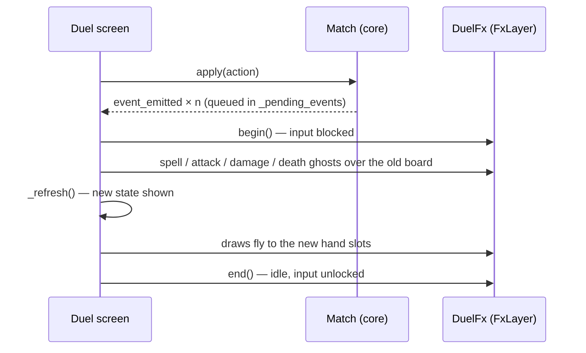

# UI implementation

> How screens and interactions from [functional/07-ui-ux.md](../functional/07-ui-ux.md) are built in Godot.
> Status: In progress · Last updated: 2026-10-30

## Display settings (`project.godot`)

| Setting | Value |
|---------|-------|
| `display/window/size/viewport_width × height` | 1080 × 1920 |
| `display/window/handheld/orientation` | Portrait |
| `display/window/stretch/mode` | `canvas_items` |
| `display/window/stretch/aspect` | `expand` (layouts use anchors/containers to absorb extra height) |
| Safe area | `ui/safe_area.gd` (`SafeArea`) reads `DisplayServer.get_display_safe_area()` (mobile only), converts it to viewport units and adds it to the root margins: menu screens (`MenuUI.screen_column`) and the duel, so nothing goes under the notch or the system bars |

## Scene composition

- One scene per screen under `scenes/screens/`, swapped by the `SceneRouter` autoload (with a fade transition): splash (title) → main menu → Quick match → duel. The main menu is the root of the back history (back quits there); leaving a duel clears the history and returns to the main menu.
- Reusable components under `scenes/components/`; the first `CardView` and portrait duel screen are implemented.
- UI built with `Control` nodes and containers; a shared `Theme` resource in `ui/theme/` for fonts, colours, styleboxes.

## Theme

- `ui/theme/main_theme.tres` is the project theme (`gui/theme/custom` in `project.godot`): every `Control` inherits it, popups and menus included.
- `ui/theme/palette.gd` (`class_name Palette`) holds the same colours as constants for scripts (`Palette.LIFE`, `Palette.ACCENT`…). Source of truth: [UI palette](../functional/08-art-and-audio.md#ui-palette). A `.tres` can't reference script constants, so a colour change must be made in both files.
- Variations instead of per-node overrides: `LabelAccent`, `LabelMuted`, `ButtonPrimary` (set with `theme_type_variation`). Avoid `theme_override_colors` in scenes.

## Splash

- `scenes/screens/splash.tscn` is the project's startup scene.
- The default Godot boot splash is disabled: `application/boot_splash/show_image=false` in `project.godot`, and `splash_screen/disable_godot_boot_splash=true` in the Android export preset. Both boot backgrounds use the clear colour (`#0E0F12`), so the launch goes straight from a dark screen to the Nothung splash. On Android 12+, the system still shows its own launch screen (app icon on that background) for a moment; it can't be removed.
- Displays the game name and subtitle with a vector sword emblem; it uses no external assets.
- The **Start** button opens the main menu.

## Menus

- `scenes/screens/main_menu.tscn`: title, Rhinegold counter, **Quick match**, **Collection**, **Settings**, and Campaign greyed out until it exists. When `SaveManager.has_match()`, it first replays the saved match: if it replays, a modal offers **Resume** (highlighted; opens the duel with `DuelSetup.resume`) or **Abandon**; otherwise the file is set aside and a short message explains it.
- `scenes/screens/quick_match.tscn`: your deck (2 × 2 tiles: faction icon, faction, Leader, border in the faction colour, gold when selected), opponent (**Random** or a deck), difficulty (Easy / Normal / Hard with a one-line description), **Play**. Random is drawn among the other factions' decks when Play is pressed. The choices are saved in `Settings` (`quick_match` section) and offered again next time.
- Card screens share three components:
  - `CardGrid` (`scenes/components/card_grid.gd`): scrolling 3-column grid of `CardView`s (zoom gesture off) scaled to the screen width, a caption under each card (`set_caption()`, faded card when not available), `card_tapped` — a press that scrolled the grid by more than a few pixels is not a tap; `show_only()` hides the cells that do not match; `sorted_cards()` sorts by faction, cost, name.
  - `CardFilterBar` (`card_filter_bar.gd`): faction chips + Filters button (with the number of active filters) + count label, unfolding the captioned chip rows (`MenuUI.chip()`, one `ButtonGroup` per row); `matches()` is static and unit-tested; presets (e.g. Owned in the deck editor).
  - `CardDetail` (`card_detail.gd`): the card large with its flavour, lines given by the screen and optional buttons; tapping outside the buttons closes it.
- `scenes/screens/collection.tscn`: every card, captions "× n" / "Not owned"; **My decks** and **Nibelheim** buttons.
- `scenes/screens/deck_list.tscn` and `deck_editor.tscn` (`DeckEditor`, `DeckEditor.deck_id` set before opening): player decks from `SaveManager`, rules in `DeckRules` (`data/decks/deck_rules.gd`: eligibility, `can_add()`, `problems()` as translation keys, `to_deck_data()` for the engine, curve and type counts).
- `scenes/screens/nibelheim.tscn`: the cards still missing copies, `SaveManager.craft()`; prices and rewards in `Progression` (`data/progression.gd`).
- `DuelSetup` carries `DeckData` (a player deck through `DeckRules.to_deck_data()`, or a starter deck) and `rewards` (Quick match: a win pays `Progression.quick_match_reward(difficulty)`; the duel pays when the match is over and takes it back if the winning play is undone).
- `scenes/screens/settings_menu.tscn`: music and sound-effect sliders (0–100 %, steps of 10), language tiles (device language, then each language under its own name). Each change goes through a `Settings.set_*()` setter, which applies it (locale, audio bus volume) and saves `settings.cfg` at once; the screen rebuilds itself after a language change. *Progress* section: **Reset progress** swaps in a confirmation (Cancel highlighted, Erase in red), then calls `SaveManager.reset_profile()` and shows "Progress reset."
> **Decision (2026-10-28):** no animation speed nor text size option in Settings.
- Menu screens are built in code with `ui/menu_ui.gd` (`MenuUI`: screen column, header with Back, labels, buttons, selectable tiles, touch-sized slider, faction order), sized for the 1080 × 1920 reference.

## CardView

- `scenes/components/card_view.gd` displays translated name/rules, Energy cost and runtime/unit stats.
- **Frame drawn in code** ([card frames](../functional/08-art-and-audio.md#card-frames)): `_card_style()` builds a rectangular `StyleBoxFlat` (`UNIT_RADIUS` / `BAND_RADIUS` corners) whose border takes the faction frame colour from `CardPalette` (`ui/theme/card_palette.gd`: faction frame / trim, card background, rarity colours, Ring) on the shared dark background. Children add the name banner (`NameBanner`, faction colour), the cost / attack / health holders (bare, no pill), the rarity badge (`RarityBadge`: letter on the rarity colour) and, for spells, artifacts and relics, the double border (`FrameBand`, `scenes/components/card_frame_band.gd`: inner line + zigzag / hatching / beads drawn in `_draw()`, behind the face; the face margin and the name banner then stop at the inner line). Sizes follow the card's size (`_face_k`), so hand, board and zoom cards share one layout.
- Highlights are a `shadow` glow on the style; neither the card nor its face clip, so the glow and the full-width name banner can draw outside the face (the rules text clips itself).
- The duel reconstructs hand/board/Leader/Energy/Life views from `Match` state after authoritative `GameEvent`s; views never mutate the rules engine.
- Exhausted and ready units have distinct visual states. Dragging, zoom and pooling are not implemented yet.

## Input

- The current interaction uses touch-friendly button targets: tap a card, then tap a legal unit/Leader target; tap an attacking unit, then its target. End Turn and Leader ability have dedicated buttons.
- The opening Redraw overlay lets the player select any subset of their hand and confirm it.
- Drag-and-drop targeting arrows and long-press zoom remain future work.
- Android back button: `NOTIFICATION_WM_GO_BACK_REQUEST` handled by `SceneRouter`: back to the previous screen (`SceneRouter.go_to()` keeps a history), or quit when there is none. `application/config/quit_on_go_back=false` so Godot does not quit on its own.

## Duel and AI

- `scenes/screens/duel.tscn` uses portrait containers for both boards, artifacts, Leaders, Energy, deck/graveyard counts, battle log and the scrollable hand.
- The duel plays the `DuelSetup` set by Quick match (`DuelSetup.next`: both decks and the AI difficulty), or Gods vs Nibelungs on Normal without one (tests). Rematches keep the setup. Redraw, action validation, turn updates, match results and rematches are wired to `Match`.
- The AI (`ai/ai_player.gd`, difficulty from the setup) runs on a `Thread` from a job of copies; the duel polls the thread each frame instead of blocking, and the main thread alone applies the returned action ([AI opponent](05-ai-opponent.md#threading)).
- A headless smoke test loads and starts the duel scene. The Android device play-through is still required before this milestone is complete.

## Animation pipeline

- The rules are resolved at once; animations only catch up (`duel.gd` `_play_fx`). The board is rebuilt **once per action**, after the events that need the old positions (spell, attack, damage, death), and before the draws, which need the new hand slots.
- `scenes/components/duel_fx.gd` (`DuelFx`, on the `FxLayer` canvas layer, between the board and the modal layer) tweens **ghost** copies of cards; the duel hides the real view while its ghost plays. `CardView.shown_instance()` gives the stats as drawn, since the match has already changed them.
- While a sequence runs, `DuelFx` stops taps (`MOUSE_FILTER_STOP`) and `_apply_action` ignores drags; the AI waits for `idle` before its next step, so each AI action is seen.
- Speed from `Settings.animation_speed` (not a user setting, not saved; 1 in the game): durations are divided by it; `0` (instant) skips the animations and refreshes at once. UI integration tests run at instant speed; `tests/integration/test_duel_fx.gd` checks the animations.

## Localisation

- `localization/strings.csv` (keys + `en`, `de`, `es`, `fr` columns; `en` is the source language), imported as Godot translations (the generated `.translation` files are git-ignored and rebuilt on import). A test fails if any key lacks a language, or if a text (other than a name) is still the English copy in all three other languages — the converter writes that copy for new cards, so they must be translated by hand in the CSV.
- Language: `Settings.language`; empty = the device language if supported, otherwise English.
- The brand texts (*Nothung*, *The Ring Card Game*) stay in English in every language.
- All visible text via `tr("KEY")`; card texts via keys built from the card ID; card types via `UI_TYPE_<TYPE>`, factions via `UI_FACTION_<FACTION>` (never an ID shown as is).
- A sentence about the player has its own key (`UI_LOG_CARD_PLAYED_YOU`: "You played a card.") instead of a "You" inserted in a template: the verb agrees differently in each language.
- Rules text with numbers uses `tr(...).format({...})`.
- Test long-text languages (German, then French and Spanish) for card text overflow; card text uses auto-shrinking `Label`/`RichTextLabel`.
- Address the player informally (*du*, *tú*, *tu*). French puts a non-breaking space before `:` `?` `!`. Quotes: „…“ (de), «…» (es), « … » (fr).
- Flavour quotes: the German column uses the **original libretto**; Spanish and French are our own translations.

### Glossary

Character and place names stay German ([Lore](../functional/02-lore-and-setting.md)). Game terms:

| English | Deutsch | Español | Français |
|---|---|---|---|
| Leader | Anführer | líder | Meneur |
| Energy | Energie | Energía | Énergie |
| Unit · Spell · Artifact · Relic | Einheit · Zauber · Artefakt · Relikt | Unidad · Hechizo · Artefacto · Reliquia | Unité · Sort · Artefact · Relique |
| Bearer | Träger | portador | porteur |
| On play · On death · At the start of your turn | Beim Ausspielen · Beim Tod · Zu Beginn deines Zuges | Al jugarse · Al morir · Al inicio de tu turno | À la pose · À la mort · Au début de ton tour |
| Flying · Guard · Charge · Invisible | Fliegend · Wache · Ansturm · Unsichtbar | Vuelo · Guardia · Carga · Invisible | Vol · Garde · Charge · Invisible |
| Valhalla (keyword and place) | Walhall | Valhalla | Walhalla |
| Redraw | neu ziehen | cambiar | repiocher |

## Performance targets

- 60 fps during animations on the reference device.
- Texture atlases / compressed textures (ETC2/ASTC) for card art; art loaded at the size it is displayed.
